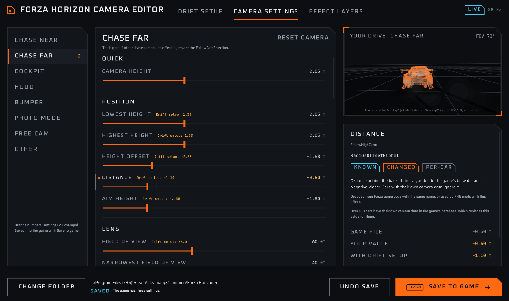
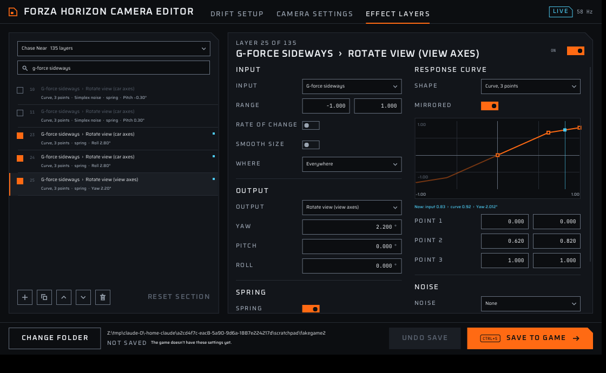

# FH6 ChaseCam

A drift chase camera for Forza Horizon 6 (PC). Low, close and wide, it looks into the corner while you drift and tips the horizon slightly, like the drift showcase clips.

by SPIRE · [drift.ph](https://drift.ph) · spireowll@gmail.com


## How FH6 camera mods work

FH6 has no scripting, but it reads two text files from `mediapc\camera` next to the game exe:

| File | What it holds |
|---|---|
| `CameraSettings.ini` | Height, distance, aim height, FOV and the springs that make each camera follow the car |
| `CameraPhysics.xml` | Effect layers per camera. Each layer reads an input (speed, G-forces, tyre slip, bumps), maps it through a curve and adds it to an output (offset, rotation, FOV) |

FH6 ChaseCam builds both files from Playground's originals. It edits the original text in place, so every line it doesn't change stays byte-for-byte stock. It replaces **Chase Far** by default, so stock Chase Near is still one button press away.

## Editor

**Forza Horizon Camera Editor** (`FH6ChaseCam.exe`) is a small Windows app (C++, Dear ImGui, Direct3D 11) that edits every camera setting FH6 reads, with a live preview. It uses the Countersteer UI kit (garage theme): graphite grounds, orange as the one accent, cut corners, Oxanium, Saira and JetBrains Mono.

Three pages:

- **Drift setup.** The quick drift camera: height, distance, aim height, field of view, rotation follow, look into the corner, horizon tilt and drift response, on Chase Near or Chase Far.
- **Camera settings.** All 140 keys of `CameraSettings.ini`, grouped by camera (Chase Near, Chase Far, Cockpit, Hood, Bumper, Photo mode, Free cam, Other), each with its unit, a typical range and a confidence label (Known, Likely, Unsure). Point at a setting to see what it does, the game's value, the value after the drift setup, the horizontal FOV for FOV keys and the swing of a spring pair. Keys the game may read but its file leaves out (from older Forza games) can be added.
- **Effect layers.** Every layer of `CameraPhysics.xml` per camera section, with a filter. Turn layers on or off, add one from a template (fixed offset, drift look, corner lean, brake dive, speed FOV, speed shake, landing jolt, idle sway), duplicate, reorder or delete. The layer form shows only the fields its switches use: input and range, rate of change, smoothing, region, output and its components, spring or kick spring, response curve with draggable points and a mirrored half, and noise.




- **Load camera** opens an existing camera as the starting point: the one in the game now, the one from before your first save, a camera mod's folder (it finds the two files inside a downloaded mod), or the original base. The files are copied next to the editor (`camera-loaded`), so saving to the game never overwrites what you are editing. Loading starts fresh: the drift setup is set to no change and your previous changes are kept in `fh6chasecam-edits.bak.txt`.
- **Full screen preview**: the button on the preview, F11 or a double-click. Esc, F11 or a double-click exits.

How it fits together:

- **Save to game** (Ctrl+S) writes both files into `mediapc\camera`: the game's own files, then your key and layer edits, then the drift setup on its chase camera. Lines and layers you didn't touch stay byte-for-byte the same, layers are written in the game's attribute order, and `NumLayers` is always the real count. On first save it backs up any camera files already there; **Undo save** puts them back. Restart FH6 to load a new camera.
- **Live preview.** The preview runs the files you are about to save: the chase camera from the ini (distance behind the car, height clamped between the lowest and highest height, the turn spring) and the camera's effect layers on top. With FH6's Data Out on it follows your real driving (speed, drift angle, tyre slip, G-forces, suspension); without it a demo drive runs. On the Effect layers page a blue marker shows each layer's current input on its curve. Inputs the preview can't produce (crashes, wind, head tracking) stay at zero. It approximates the game; FH6 is the final check.
- None of this is documented by Playground. Meanings come from Forza Horizon 1 game code (same key names and layer format), FH4's own `CameraPhysics.xml` and patterns in FH6 camera files, so every setting carries a confidence label. Many cars have their own camera position in the game's database, which replaces the global position keys for them.

Setup:

1. Choose your FH6 folder (the one with `forzahorizon6.exe`, or the Xbox app's `Content` folder). FH6 keeps its own camera files packed, so the editor builds on loose camera files: ones found in the game folder, then the camera files that were in `mediapc\camera` before its first save (another camera mod), then a `camera-base` folder next to the exe. Until it finds some, the pages show typical values and layers can't be edited.
2. In FH6: Settings > HUD and Gameplay > Data Out **On**, IP `127.0.0.1`, port `5607` (or the port set in the editor; ports 5200 to 5300 are taken by the game).

Settings are kept in `fh6chasecam-editor.ini` and your edits in `fh6chasecam-edits.txt`, both next to the exe.

### FOV live test

`FH6FovTest.exe` is a small separate tool to find out whether FH6 picks up camera file changes without a restart. Put it next to `FH6ChaseCam.exe`. Each time you move its slider it writes a FOV change into the game's camera files (as an always-on FOV layer on both chase cameras, in the settings file, or both). It backs up the camera files first and puts them back when you close it. Build it with `sh editor/build.sh fovtest`.

### Build the editor

```sh
sh editor/build.sh          # Linux with mingw-w64, or MSYS2 MinGW64 on Windows
sh editor/build.sh test     # native core tests
sh editor/build.sh test --ref DIR   # also check against real camera files in DIR
```

Output: `editor/build/FH6ChaseCam.exe`, a single static exe.

## Command-line builds

The same edits as a Python script, for making release zips.

1. Copy `CameraSettings.ini` and `CameraPhysics.xml` from your FH6 install (the game's own, not another mod's) into `stock/`.
2. Run:

```sh
python3 build.py            # all presets
python3 build.py drift      # one preset
```

Output: `dist/<preset>/mediapc/camera/` and `dist/fh6-chasecam-<preset>-v<version>.zip`.

| Preset | What it does |
|---|---|
| `drift` | The editor's defaults: about 0.7 m lower, 0.5 m closer, +6° FOV, looser rotation follow, corner aim 6°, drift tilt 3°, extra speed FOV |
| `calibrate` | Test build: only big drift effects (corner aim 20°, tilt 15°) on Chase Far, to confirm which way each effect turns in game |

Values in a preset: a number replaces the stock value, `rel(x)` adds to it, `scale(x)` multiplies it. The editor and `build.py` produce byte-identical files for the same settings.

### Calibrating directions

Install the `calibrate` build, pick Chase Far and hold a **left-hand** drift. The view should turn left (into the corner) and the horizon should tip toward the outside. If either goes the other way, flip `AIM_SIGN` or `TILT_SIGN` in `presets.py` (or the two flip switches in the editor) and rebuild.

## Install a zip

- **Steam:** copy the `mediapc` folder into the folder with `forzahorizon6.exe`.
- **Xbox app / Game Pass:** copy it into the game's `Content` folder, for example `D:\XboxGames\Forza Horizon 6\Content`, and let it merge.

Back up any files already in `mediapc\camera` first. To uninstall, delete the two files or restore the backups.

Recommended in game: Motion Blur on Long. Try the built-in Drift camera too (Settings > HUD and Gameplay).

## Test

```sh
python3 tests/test_build.py      # Python generator
sh editor/build.sh test          # C++ core
```

`editor/tests/fake_dataout.py` sends fake Data Out packets, to try the editor's live mode without the game.

## Credits

Preview car: ["Nissan Silvia Drift Tuned (S15)"](https://sketchfab.com/3d-models/nissan-silvia-drift-tuned-s15-84b63a057e36488589392a19b9313e2b) by [VuckyZ](https://sketchfab.com/VuckyZ123), licensed under [CC BY 4.0](https://creativecommons.org/licenses/by/4.0/). Changed: interior, suspension and brakes removed, simplified to about 3,900 triangles, rescaled, materials dropped (`editor/tools/s15_convert.py`).

[Dear ImGui](https://github.com/ocornut/imgui) (MIT). Oxanium, Saira and JetBrains Mono fonts (SIL Open Font License, `editor/fonts/OFL-*.txt`); `editor/fonts/embed.sh` rebuilds the embedded copies.

## Note

Playground does not support mods, and changing game files is at your own risk.
