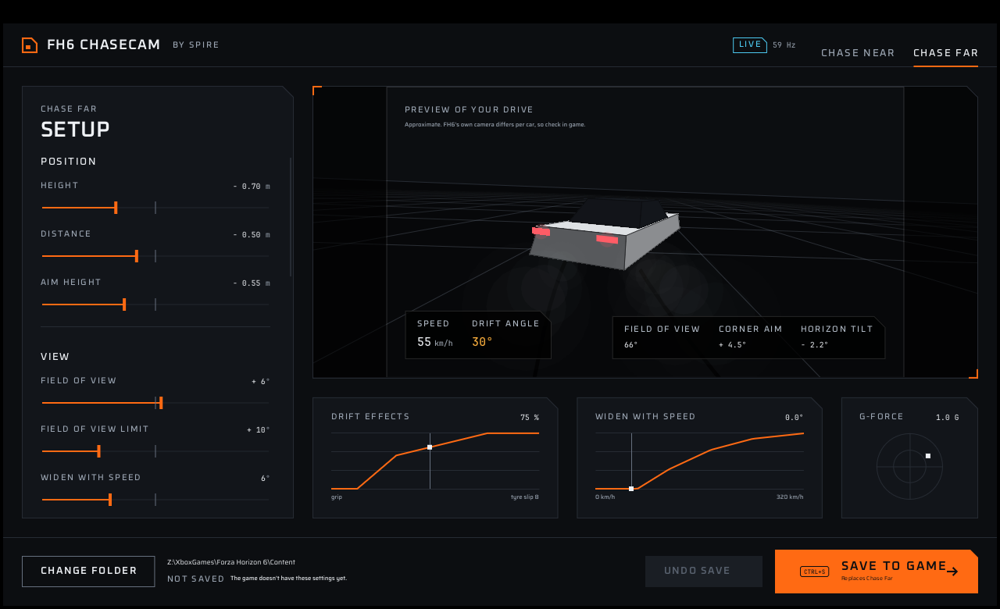

# FH6 ChaseCam

A drift chase camera for Forza Horizon 6 (PC). Low, close and wide, it looks into the corner while you drift and tips the horizon slightly, like the drift showcase clips.

by SPIRE · [drift.ph](https://drift.ph) · spireowll@gmail.com



## How FH6 camera mods work

FH6 has no scripting, but it reads two text files from `mediapc\camera` next to the game exe:

| File | What it holds |
|---|---|
| `CameraSettings.ini` | Height, distance, aim height, FOV and the springs that make each camera follow the car |
| `CameraPhysics.xml` | Effect layers per camera. Each layer reads an input (speed, G-forces, tyre slip, bumps), maps it through a curve and adds it to an output (offset, rotation, FOV) |

FH6 ChaseCam builds both files from Playground's originals. It edits the original text in place, so every line it doesn't change stays byte-for-byte stock. It replaces **Chase Far** by default, so stock Chase Near is still one button press away.

## Editor

`FH6ChaseCam.exe` is a small Windows app (C++, Dear ImGui, Direct3D 11) to tune the camera with a live preview. It uses the Countersteer UI kit (garage theme): graphite grounds, orange as the one accent, cut corners, Oxanium, Saira and JetBrains Mono.

- Sliders for height, distance, aim height, field of view, rotation follow, look into the corner, horizon tilt and drift response. Right-click a slider to reset it, double-click to type a value.
- **Live preview.** With FH6's Data Out on, the preview follows your real driving: speed, drift angle, tyre slip and G-forces. Without it, a demo drive runs. The preview approximates the game's camera; FH6 is the final check.
- **What the camera reacts to.** Curves for the drift effects and speed widening, with a marker at your current slip and speed, plus a G-force circle.
- **Save to game** (Ctrl+S) writes `mediapc\camera` in the game folder. On first save it backs up any camera files already there; **Undo save** puts them back. Restart FH6 to load a new camera.

Setup:

1. Choose your FH6 folder (the one with `forzahorizon6.exe`, or the Xbox app's `Content` folder). The editor finds the game's own camera files in it.
2. In FH6: Settings > HUD and Gameplay > Data Out **On**, IP `127.0.0.1`, port `5607` (or the port set in the editor; ports 5200 to 5300 are taken by the game).

Settings are kept in `fh6chasecam-editor.ini` next to the exe.

### Build the editor

```sh
sh editor/build.sh          # Linux with mingw-w64, or MSYS2 MinGW64 on Windows
sh editor/build.sh test     # native core tests
```

Output: `editor/build/FH6ChaseCam.exe`, a single static exe.

## Command-line builds

The same edits as a Python script, for making release zips.

1. Copy `CameraSettings.ini` and `CameraPhysics.xml` from your FH6 install (the game's own, not another mod's) into `stock/`.
2. Run:

```sh
python3 build.py            # all presets
python3 build.py drift      # one preset
```

Output: `dist/<preset>/mediapc/camera/` and `dist/fh6-chasecam-<preset>-v<version>.zip`.

| Preset | What it does |
|---|---|
| `drift` | The editor's defaults: about 0.7 m lower, 0.5 m closer, +6° FOV, looser rotation follow, corner aim 6°, drift tilt 3°, extra speed FOV |
| `calibrate` | Test build: only big drift effects (corner aim 20°, tilt 15°) on Chase Far, to confirm which way each effect turns in game |

Values in a preset: a number replaces the stock value, `rel(x)` adds to it, `scale(x)` multiplies it. The editor and `build.py` produce byte-identical files for the same settings.

### Calibrating directions

Install the `calibrate` build, pick Chase Far and hold a **left-hand** drift. The view should turn left (into the corner) and the horizon should tip toward the outside. If either goes the other way, flip `AIM_SIGN` or `TILT_SIGN` in `presets.py` (or the two flip switches in the editor) and rebuild.

## Install a zip

- **Steam:** copy the `mediapc` folder into the folder with `forzahorizon6.exe`.
- **Xbox app / Game Pass:** copy it into the game's `Content` folder, for example `D:\XboxGames\Forza Horizon 6\Content`, and let it merge.

Back up any files already in `mediapc\camera` first. To uninstall, delete the two files or restore the backups.

Recommended in game: Motion Blur on Long. Try the built-in Drift camera too (Settings > HUD and Gameplay).

## Test

```sh
python3 tests/test_build.py      # Python generator
sh editor/build.sh test          # C++ core
```

`editor/tests/fake_dataout.py` sends fake Data Out packets, to try the editor's live mode without the game.

## Credits

[Dear ImGui](https://github.com/ocornut/imgui) (MIT). Oxanium, Saira and JetBrains Mono fonts (SIL Open Font License, `editor/fonts/OFL-*.txt`); `editor/fonts/embed.sh` rebuilds the embedded copies.

## Note

Playground does not support mods, and changing game files is at your own risk.
